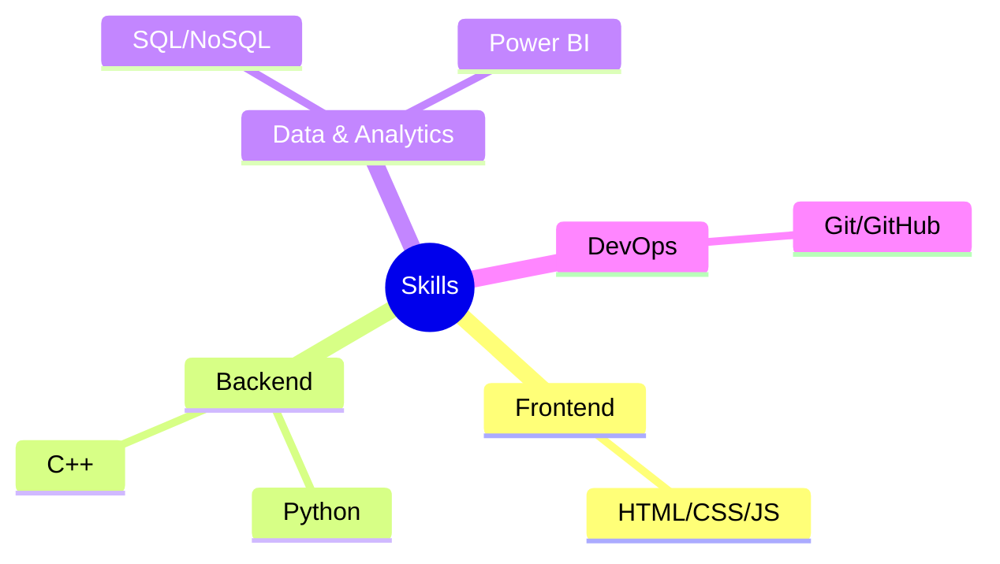

# Profile

<div align="center">

# Welcome, I'm Allan Almeida 


<br/>

### Passionate about building robust solutions and ensuring software quality

<br/>

[](https://www.linkedin.com/in/allan-almeida-8b90772a4//)
[](mailto:allan.oficina01@gmail.com)

</div>

<br/>

<div align="center">

## About Me

</div>

<table align="center">
<tr>
<td width="50%">

```typescript
class FullstackDeveloper {
    constructor() {
        this.name = "Allan Almeida";
        this.role = "Fullstack Developer & cybersecurity";
        this.location = "São Paulo, Brazil";
        this.email = "allan.oficina01@gmail.com";
        this.languages = [
            "Portuguese (Native)",
            "English (basic)"
        ];
        this.specialties = [
            "Software Development",
            "Kali linux",
            "Data Analysis"
        ];
        this.focus = [
            "Red Team",
            "Test-Driven Development",
            "back end"
        ];
    }
    
    getCurrentStatus(): string {
        return "tests vulnerability";
    }
}
```

</td>
<td width="50%">

<div align="center">
    

</div>

</td>
</tr>
</table>

<div align="center">

### Professional Summary

</div>

Security professional with a focus on red team. College training impacts cybersecurity.

Experience spans across frontend and backend development, kali linux, and business intelligence.

<div align="center">

### Professional Experience


</div>


## Technical Skills



<div align="center">

## Technology Stack
</div>

<table align="center">
<tr>
<td width="50%" valign="top">

### Frontend Development
<div align="center">


</div>

### Backend Development
<div align="center">


</div>
### Database & Data
<div align="center">


</div>

### DevOps & Tools
<div align="center">


</div>

</td>
</tr>
</table>

</div>

<div align="center">

### Microsoft Office Suite


</div>

<div align="center">

<div align="center">


## Featured Projects


</div>

<table align="center">
<tr>
<td align="center" width="50%">
<br/>
<h3>BuscaJogos+ Platform</h3>
<b>Game Price Comparison System</b><br/>
<i>Web platform for searching and comparing digital game prices across multiple stores</i><br/>
<br/>
<b>Technologies:</b> Golang, C#, Blazor, MySQL, Docker, Swagger<br/>

</td>
<td align="center" width="50%">
 
<h3>Projeto Mitra</h3>
<b>CRM for Small Businesses</b><br/>
<i>Desktop CRM system for blind and curtain companies with order and quote management</i><br/>
<br/>
<b>Technologies:</b> Python, tkinter, SQLite3, pytest, pyinstaller<br/>

</td>
</tr>
</table>

<div align="center">

## Languages

</div>

<table align="center">
<tr>
<td align="center" width="25%">
<br/>
<b>Portuguese</b><br/>

</td>
<td align="center" width="25%">
<br/>
<b>English</b><br/>

</td>
<td align="center" width="25%">
<br/>
<b>French</b><br/>

</td>
<td align="center" width="25%">
<br/>
<b>Spanish</b><br/>

</td>
</tr>
</table>

<div align="center">

## GitHub Analytics

</div>

<table align="center">
<tr>
<td width="50%">

</td>
<td width="50%">

</td>
</tr>
</table>

<div align="center">
  
</div>

---

<div align="center">

### *"Quality code is not an accident; it is the result of intelligent effort."*


<br/>


</div>
